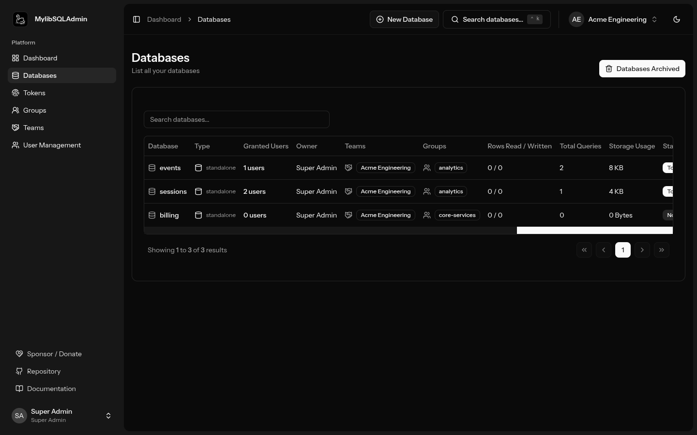
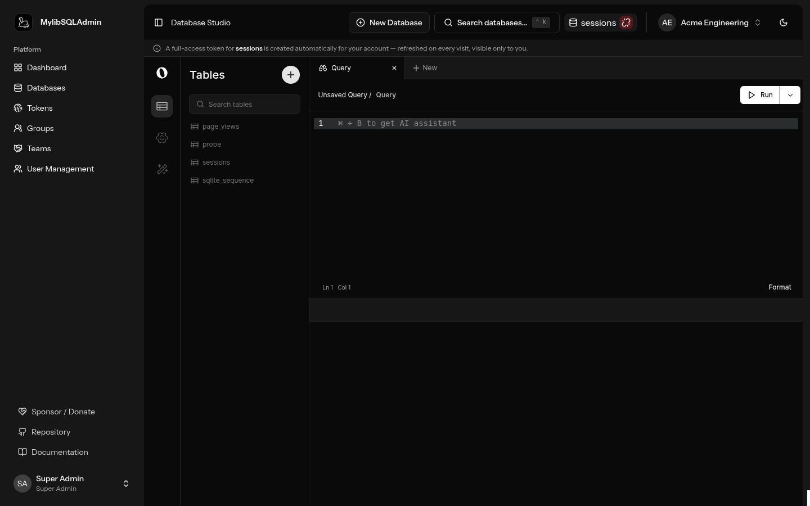

<p align="center">
  <picture>
    <source media="(prefers-color-scheme: dark)" srcset="https://raw.githubusercontent.com/darkterminal/darkterminal/master/projects/dark-mode.png">
    <source media="(prefers-color-scheme: light)" srcset="https://raw.githubusercontent.com/darkterminal/darkterminal/master/projects/light-mode.png">
    
  </picture>
</p>
<p align="center">A Modern libSQL Database Management Platform — Web GUI + CLI</p>

<p align="center">
  <a href="https://deepwiki.com/darkterminal/mylibsqladmin" target="_blank">
    
  </a>
  <a href="https://github.com/sponsors/darkterminal" target="_blank">
    
  </a>
  <a href="https://discord.gg/wWDzy5Nt44" target="_blank">
    
  </a>
  
  
  
</p>

<hr />

In the age of data-driven applications, the demand for lightweight, scalable, and modern database solutions has never been greater. **libSQL** is a powerful fork of SQLite designed for the modern era, offering advanced features such as serverless and server-based modes, fine-grained access control, and native branching capabilities.

**MylibSQLAdmin** is an open-source platform for managing libSQL databases. It ships two clients for the same admin API: an intuitive **web GUI** for day-to-day administration and **`libsql3`**, a PHP CLI for terminal workflows and scripts. By harnessing the full potential of libSQL-server functionalities, the platform makes it easier to manage databases from the interface you prefer. You can connect with `libsql-server` from **Docker Service** or use your existing `libsql-server` instance.

<p align="center">
    
</p>
<p align="center">
    
    
</p>
<p align="center">
    <a href="https://www.youtube.com/watch?v=dntNiEYA4mU" target="_blank">Watch the demo on YouTube</a>
</p>

## What Does MylibSQLAdmin Offer?

-   **Simple Database Statistics** - Get quick insights into your database performance with easy-to-understand stats.
-   **Database Management** - Create, edit, and manage your databases with intuitive tools.
-   **Token Management** - Secure and control access to your system using token-based authentication.
-   **Group Management** - Organize users into groups for better structure and permission handling.
-   **Team Management** - Collaborate efficiently by managing teams and their access levels.
-   **User Management** - Easily handle user accounts, roles, and activity logs.
-   **Member Invitation Management** - Invite new members and track their onboarding status with ease.
-   **CLI Access** - `libsql3` manages identity, teams, groups, databases, and tokens from the terminal. It provides an interactive REPL by default and one-shot commands for scripts. Read it on the [published CLI docs](https://darkterminal.github.io/mylibsqladmin/cli/), or in the repository: [libsql3 CLI manual](docs/libsql3-man.md) and [generated command reference](docs/libsql3-cli-reference.md).

## Support this Project

<p align="center">
    <a href="mailto:darkterminal@duck.com" target="_blank"></a>
    via <a href="https://github.com/sponsors/darkterminal">GitHub Sponsor</a> (Global) / via <a href="https://saweria.co/darkterminal" target="_blank">Saweria</a> (Indonesian)
</p>

## Requirements

-   Docker & Docker Compose (default engine). Kiri can be used instead for local development — see [Contributing: Development Environment](CONTRIBUTING.md#development-environment).
-   openssl
-   PHP 8.4 with `pdo_sqlite`, `mbstring`, and `intl` if you run `libsql3` from source or from the verified PHAR.

## Getting Started

Make sure the installer script is running inside your preferred directory!

```
curl --proto '=https' --tlsv1.2 -LsSf https://raw.githubusercontent.com/darkterminal/mylibsqladmin/refs/heads/main/scripts/installer.sh | sh
```

or read the [Manual Installation Guides](docs/README.md). For a custom domain
with TLS termination, see [Custom domain + TLS](docs/README.md#custom-domain--tls).

### Bootstrap

Fresh production installs create **no** default accounts. Bootstrap your super-admin with:

```bash
docker compose exec webui php artisan db:seed --class=BootstrapSeeder
```

If `LIBSQL_SEED_DEMO_USERS=true` is set in the environment, demo users are created for local testing only — **never set it in production**.

### CLI quick start

`libsql3` lives in this repository and talks to the same platform API as the web GUI. With no arguments it opens the interactive REPL; with arguments it runs one command and exits.

```bash
php libsql3/libsql3 --version
export LIBSQL_API_ENDPOINT=https://admin.example.com
php libsql3/libsql3 auth:login <username>
php libsql3/libsql3 db:list
```

For the verified PHAR, install/upgrade instructions, endpoint policy, and workflows, read the [libsql3 CLI manual](docs/libsql3-man.md). Command names, arguments, options, and defaults are generated in the [CLI reference](docs/libsql3-cli-reference.md). One-shot output is human-readable, not a stable machine contract; automation should call the platform API directly.

## Contributors

Contributions to both the web application and `libsql3` are welcome. See [CONTRIBUTING.md](CONTRIBUTING.md) for setup, test commands, and generated-docs rules.

[](https://github.com/darkterminal/mylibsqladmin/graphs/contributors)

## Star History

[](https://www.star-history.com/#darkterminal/mylibsqladmin&Date)
